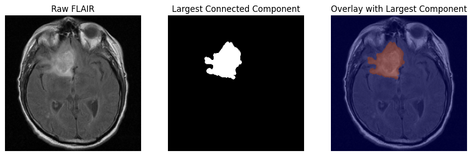
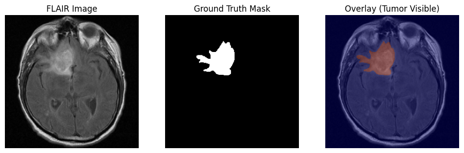
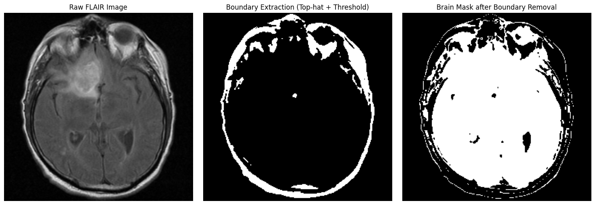
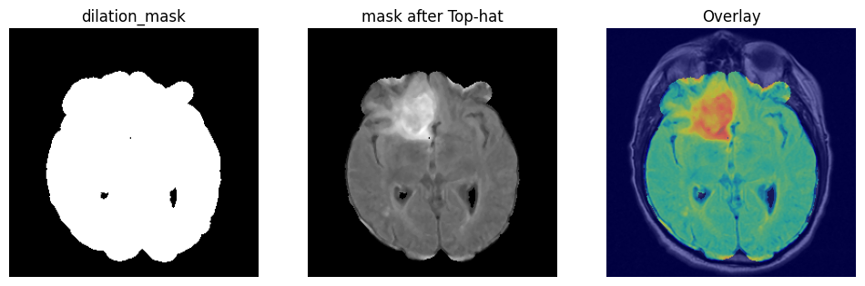
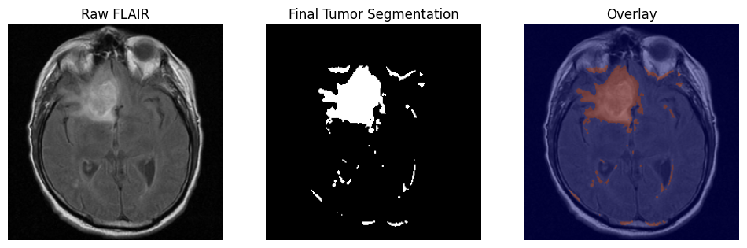

# Morphology-based Brain Tumor Segmentation

Segmenting a brain tumor in an MRI slice using only classical image processing: thresholding and mathematical morphology. No neural network, no training data, and no GPU needed.



## How it works

The idea is to remove everything that is not brain tissue, then pick out the brightest local region inside the brain. That region is the tumor, because tumors appear bright on FLAIR MRI.

| Step | What happens | Tools |
|---|---|---|
| **Preprocess** | Clip intensities to the 1st–99th percentile and rescale, which tames bright outliers while keeping local tumor contrast. Then a 3×3 median filter removes noise. | `percentile`, `cv2.medianBlur` |
| **1. Remove skull and boundary** | Bright skull and scalp structures are found with a white top-hat (disk 15) plus Otsu threshold, then subtracted from an Otsu brain mask. | `white_tophat`, Otsu |
| **2. Clean the brain mask** | Erosion (disk 9) followed by dilation (disk 11) removes thin leftover fragments. The mask is applied to the image, then a large white top-hat (disk 55) highlights bright regions inside the brain. | `erosion`, `dilation`, `white_tophat` |
| **3. Threshold** | A fixed threshold (125) turns the top-hat output into tumor candidates, then a small opening (disk 3) removes specks. Some false positives remain near the skull. | `cv2.threshold`, opening |
| **4. Keep the largest component** | Connected-component analysis keeps only the biggest blob, which discards the remaining false positives. | `cv2.connectedComponentsWithStats` |

### Step by step

**Input: FLAIR slice and the doctor's ground-truth mask**


**Step 1: skull and boundary removal.** Left to right: raw slice, extracted boundary, brain mask after removal.


**Step 2: brain mask after morphology, and the top-hat response.** The tumor stands out as the brightest region.


**Step 3: thresholded tumor candidates.** The tumor is found, with a few small false positives.


**Step 4: largest connected component.** The false positives are gone, and the result closely matches the ground truth above.


## Dataset

[LGG MRI Segmentation](https://www.kaggle.com/datasets/mateuszbuda/lgg-mri-segmentation) from Kaggle (FLAIR slices with manual tumor masks, 110 patients, from The Cancer Imaging Archive). The example uses patient `TCGA_CS_4941_19960909`, slice 12.

## Run it

The notebook was written for Google Colab and reads the dataset from Google Drive. To run it elsewhere, change `DATASET_DIR` to wherever you downloaded the dataset.

```bash
pip install opencv-python scikit-image numpy matplotlib
jupyter notebook Morphology_based_Brain_Tumor_segmentation.ipynb
```

## Limitations

- Shown on a single example slice. There is no quantitative evaluation across the dataset yet.
- Thresholds and structuring-element sizes are tuned by hand for this kind of slice and may need adjusting for others.
- Keeping only the largest component assumes one main tumor region per slice.

## Tools

Python, OpenCV, scikit-image, NumPy, Matplotlib.
